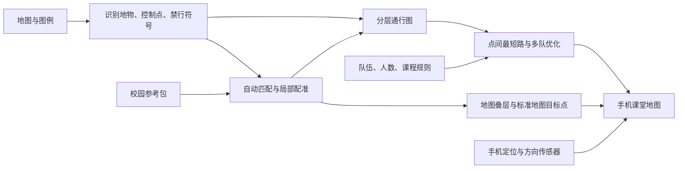

# DirMap：深圳大学定向越野地图软件实施方案

> 这是 2026-10-14 的设计阶段记录。2026-10-15 已继续开发实际应用，当前实现和未完成项见 [实施状态](../IMPLEMENTATION_STATUS.md)。本记录中的“方案完成”不表示软件已完成；验收要求仍需逐项落实。

方案日期：2026-10-14。范围依据用户最后的限定：在有限磁盘空间内完成**具体实现方案的探索与敲定**。本目录交付架构、算法、接口、实施顺序、验收办法和小型验证记录；成品应用、三图实际识别与校园实测属于后续实施。

**选定方案：教师网页端处理地图，学生手机网页端导航；高德 JS API 2.0 提供标准底图，服务端生成经过配准的地图叠层、目标点和校园通行图；手机本地处理朝向；自建通行图上的最短路与多队优化负责路线。** 原始图像识别在备课时完成，课堂中只定位、旋转、显示已发布数据和必要的重规划。

原图视觉内容尚未核验。本文不会把文件名、色彩惯例或合成实验当作三张地图的真实内容。证据及其适用范围见 [sources.md](../evidence/sources.md) 和 [validation-plan.zh-CN.md](validation-plan.zh-CN.md)。

## 1. 产品行为与默认设置

教师流程：建立校园项目 → 导入地图及图例 → 自动识别、自动配准 → 查看低置信度和冲突位置 → 设定目标点、队伍与课程规则 → 生成路线 → 发布课堂链接。学生打开链接、选择队伍、点击“开始定位与朝向跟随”，看到底图、目标、当前位置、路线和方向。配准、识别的人工纠错结果进入下一次自动处理使用的校园参考包。

必须实现自动识别与自动通过质量门槛的路径；仅提供手工标点、手动画路不算三个功能的完整交付。首次缺乏地理参照时，需要准备参考数据；自动化不等于能从任意无地理参照图片唯一恢复真实位置。

| 决策 | 默认值与允许的变化 |
| --- | --- |
| 课堂任务 | `all_visit`：每队完成全部必到点；一人可视作一队 |
| 其他模式 | `split_coverage`：全班分担，每点分配给一队；`fixed_order`：必须按教师指定顺序 |
| 目标函数 | 先最小化最后一队完成时间，再最小化总耗时；可改为最短总距离 |
| 起终点 | 教师显式指定；支持同点返回或不同终点，不根据图片边界猜测 |
| 参与人数 | 录入每队人数；只给总人数 N 和队数 K 时均衡分组，满足人数总和 N、每队至少一人；split_coverage 默认每队至少分到一个目标，K 大于目标数时要求调整 |
| 通行规则 | 已确认合法可通行区域参与求解；禁止区域作为硬约束，未知区域待核验 |
| 朝向模式 | 手机指向跟随；无可靠罗盘而有可靠运动航向时显示“行进方向跟随”；可切北向上 |
| 校园范围 | 建项时确定校区/范围，图名或 OCR 可建议；三张图不预设一定相邻或来自同一校区 |

“人多”本身不会改变几何最短路。人数通过队伍数量、队伍速度、控制点服务时间、通道容量和出发安排进入模型，不使用“距离乘人数”冒充人群优化。

## 2. 技术选型

| 部分 | 采用 | 取舍 |
| --- | --- | --- |
| 教师与学生界面 | TypeScript + Vue 3 + Vite；响应式网页，可加 PWA 外壳 | 共用类型和地图组件；无需安装手机应用即可试课 |
| 标准底图 | 高德 JS API 2.0，2D、俯仰角 0 | 面向深圳课堂；点、线、自有 XYZ 栅格叠层均由一个地图引擎展示 [S1–S3] |
| 服务接口 | Python 3.12 + FastAPI | 图像与优化处理集中在服务端；本机已有 Python 3.14 只运行标准库验证 |
| 图像处理 | NumPy + `opencv-python-headless`；小范围数字 OCR 按需接入 Tesseract | 先用颜色、形状、拓扑和模板；三图不足以支撑从零训练通用深度模型 |
| 配准与几何 | SciPy：三角剖分/稀疏最小二乘；Shapely 2：拓扑、障碍相交检查 | 默认分片仿射；保留 TPS 对照实验，不把高阶形变作为固定首选 |
| 路线优化 | 自建稀疏图的 Dijkstra/A* + OR-Tools Routing/CP-SAT | Routing 产生快速可行解；精确解与最优证明由 DP 或 CP-SAT 提供 [S8] |
| 存储与任务 | SQLite + 文件目录；单独一个处理 worker，任务表轮询 | 三图/单课堂无需 PostGIS、Redis、Kubernetes；大规模并发时才升级 |

实施环境先锁定 Python 3.12 和上述组件的兼容版本，远端解析依赖后提交锁文件。本文不声称未安装的软件组合已验证兼容。GDAL 可在 WGS84 数据的配准对照中使用；默认 GCJ02 项目不依赖 GDAL，也不把 GCJ02 冒写成某个 EPSG 投影。

## 3. 现有输入与参考数据

当前五份原始文件共 7,175,078 字节，见带 SHA-256 的 [input-manifest.json](../evidence/input-manifest.json)。

| 文件 | 已验证元数据 | 尚未验证 |
| --- | --- | --- |
| `image_1791593207568.jpg` | JPEG，1649×2176，无 EXIF GPS IFD | 校区、比例尺、方向、控制点、通行细节 |
| `image_1791593257267.jpg` | JPEG，986×735，无 EXIF GPS IFD | 同上；低分辨率下细墙/门洞识别尤其需要检查 |
| `image_1791942468319.jpg` | JPEG，2555×2585，无 EXIF GPS IFD | 同上 |
| `____________aigc_label.png` | PNG，1551×1048，RGBA | 是否为另一张图例及具体符号内容 |
| `ISSprOM2019-2图例.pdf` | 单页、OCAD 12.1.8 创建；允许复制；文字提取为 0 个非空白字符 | 实际版次与符号外观；文件名不能证明内容完全符合当前标准 |

现有资料没有可直接使用的校园坐标参考包，也没有 `.ocd/.omap/.geotiff` 等地理工程文件。不能仅从图像相对布局确定绝对经纬度、可靠门洞状态或真实比例。

参考包按以下顺序建立：

1. 优先使用已有地理定位的校园 GIS/测绘数据；若以后获得 OCAD/OpenOrienteering 工程，读取其已有地物与地理参照，仍检查源坐标系。
2. 没有校园 GIS 时，按选定校园边界通过 Overpass 获取有限区域的 OSM 建筑轮廓、道路、水体、桥隧及访问标签，作为匹配候选 [S10]。保留下载日期、来源和署名；本次未查询三个校区的实际覆盖率，**不能假定 OSM 校内门洞与小路完整**。
3. 对参考包缺少的区域，补充 12–20 个分布均匀的建筑角、路口或水体转角及其坐标。这是可复用的首次地理标定；自动匹配失败时教师也可以纠正点对。使用 POI 中心替代建筑角会形成系统误差，应分开建模。
4. 高德 SDK 用于底图展示和坐标转换；并不等同于提供可下载的校园建筑矢量数据库。禁止把“能看到高德楼块”当作“已获得匹配所需建筑边界”。如使用其他栅格参考，须有可使用的地理参照及数据获取途径。

参考包至少保存：范围、地物几何、稳定特征点、坐标基准、来源与日期、测量/点击精度、拟合用点与独立核查点。后续自动匹配复用参考包，不要求每次重新标同一校园。

## 4. 坐标与变换链

**默认项目采用明确标记的 GCJ02 底图坐标及其校园局部米制平面。** 这是选定国内底图后的工程取舍。原始 GNSS 的 WGS84 数据独立保存，通过官方转换服务进入 GCJ02；已由高德返回的 GCJ02 数据不得再次转换 [S1]。

| 空间 | 用途与约定 |
| --- | --- |
| 原始像素 | 左上角原点，u 向右、v 向下；记住裁切/EXIF/照片纠偏变换；像素中心采用 `(i+0.5,j+0.5)` |
| 归一像素 | 去边框/透视后的图幅；拟合时转为 y 向上的统一约定，保留回到原图的矩阵 |
| 校园局部平面 | `frameId` 唯一、x 向东 y 向北、单位米；拟合、相交、路径长度与误差在这里计算 |
| 展示经纬度 | `{crs:"GCJ02",lng,lat}`，传入高德覆盖物 |
| 原始 GNSS | `{crs:"WGS84",lng,lat}` + accuracy/speed/time；官方转换成功前不冒充高德坐标 |

局部平面采用 `LOCAL_GCJ02_ELLIPSOIDAL_LINEAR_V1`。原点为校园中心的 GCJ02 经纬度 `(λ0,φ0)`；角度转弧度，取椭球常数 `a=6378137`、`e²=0.00669437999014`，`N=a/sqrt(1-e²sin²φ0)`、`M=a(1-e²)/(1-e²sin²φ0)^(3/2)`，定义 `x=(λ-λ0)Ncosφ0`、`y=(φ-φ0)M`。反变换按同一原点和参数计算。

这是一种用于校园范围相对测量的局部参数化，**不是 WGS84/UTM，也不是测绘级真实长度证明**。首期限制原点半径 3 km，实测已知路段长度偏差目标 ≤1%；超范围需重建工程坐标方案。WGS84 真值与 GCJ02 点击坐标不直接放进一个拟合数组。需要标准 GeoJSON 导出时，只有具备明确 WGS84 地理参照的结果才能按 RFC 7946 导出；GCJ02 数据使用带 crs 的应用 JSON，不能仅换标签。

用于叠层的 XYZ 网格由 GCJ02 经纬度按 Web Mercator 数学公式投影，内部标为 `GCJ02_WEB_MERCATOR`；它不等价于 EPSG:3857 的 WGS84 数据。渲染像素、点、线均经过同一注册版本，避免底图对上而控制点或路线错位。

## 5. 自动配准、拼合与目标点投影

### 5.1 识别与候选匹配

1. 校验图像尺寸、方向、裁切范围；只在确实是拍摄纸图且能识别边界时做透视纠偏。**拍照透视**与**地图制图局部变形**是不同问题，分别记录变换。
2. 转 Lab/HSV，做局部白平衡和自适应颜色聚类；按图例版次提取建筑轮廓、道路交叉、水体边缘等稳定地物。边框、图例区、文字区排除在匹配 ROI 外。
3. 紫色内容分成三路：控制点/起终点；连接线/编号；禁行边界与禁区。可从地物匹配图中掩去干扰，但保留原图和独立的课程禁行层，不能把全部紫色当噪声抹掉。
4. 从地物生成形状和邻域描述：转角、边长比例、路口度数、相邻建筑的相对布局、轮廓距离；在校园参考包中检索相容候选。先匹配地物类型，再用邻域拓扑/几何验证。ORB/SIFT 仅作为同类图像的辅助基线，不假定定向图与卫星影像能直接可靠匹配 [S6]。
5. 用 RANSAC 估计仿射初始模型，剔除错误对应。最低数学要求为 3 个非共线点，自动发布要求更高：至少 8 个稳定内点且覆盖课程范围；正常准备 12–20 个分布点。四点单应矩阵只解决合适的整体透视，不能解释任意局部伸缩。

### 5.2 选择局部变形模型

先验证全局仿射的独立误差；合格则保留简单模型。若误差存在有规律的局部分布，采用**正则化分片仿射**：

- 在分布良好的拟合锚点上做 Delaunay 三角剖分；目标点/地物在三角形内用重心坐标变换。保留原始拟合点与经过正则化的网格顶点。
- 将残差位移 `δ` 在邻接网格上平滑，最小化 `Σ wi‖F(pi)-qi‖² + λΣ(i,j)‖δi-δj‖²`；权重来自参考精度与匹配置信度。λ 在开发集交叉验证中确定，独立验收点不参与选 λ。
- 检查非退化三角形、目标边界自交、非邻接三角形重叠、异常拉伸与 Jacobian 符号；发现折叠即失败。原图 y 向下引起的整体符号变化先归一处理，不能误判为折叠。
- 有效域是核验过的锚点包围范围。凸包外不无条件外推；补点或明确留空。低纹理区域、薄长三角形和远离锚点的目标进入待核验。
- TPS 可在相同独立点上与分片仿射比较；只有误差与无折叠检查都更好时才替换。TPS 穿过拟合点不代表真实误差小，稠密 GCP 还增加内存代价 [S7]。

合成探针在 8 个未用于拟合的位置上，全局仿射 RMSE 约 5.10 m，分片模型约为数值零。这是由独立解析函数构造的分片形变样例，验证“局部模型能表达全局模型表达不了的变形”；**不证明真实三图可达到该误差**。

### 5.3 控制点与三图拼合

按 703 控制圈、701 起点、706 终点等图形和编号提取候选；圆/椭圆拟合中心、连通域、开口圆弧与局部 OCR 联合判断，区分图例示意和真实课程。对重叠圈、断圈、重复编号、缺失编号、圈中图形遮挡输出候选和置信度。保留 `control_id` 与可修改编号的分离，教师可新增/修正目标点。

从归一图坐标经 `F` 到局部平面，再到 GCJ02，即得到目标显示位置；图层配准版本、目标点版本与通行图版本一起发布。点的真实图示位置与可走的接近节点分别保存，防止为了“吸附到路”把目标移到墙另一侧。

三图分别对同一参考框架配准后再合并；不同校区建立不同项目。重叠区用独立公共地物测量接缝误差；按明确的资料日期/教师核验选择地物来源。任一可信图存在禁行约束时，冲突边先关闭待核验，不能多数投票自动删掉围墙。

叠层在 worker 内反向采样成有限校园范围的透明 XYZ 瓦片，提供给 `AMap.TileLayer` [S2]。每个目标瓦片像素由 GCJ02 网格反算局部点，定位有效目标三角形，再反算原图像素；图像用双线性采样，分类/禁行掩膜用最近邻。瓦片裁切到有效域，变换后的整张图不能简单塞进一个矩形 ImageLayer 代替局部变形。缩放上限依据原图有效米/像素确定，避免无限放大制造精度假象。

## 6. 手机朝向跟随

浏览器方案要求 HTTPS 和用户的一次显式按钮操作来申请定位/方向权限；这是浏览器接口前提，不是每次旋转弹窗 [S4]。学生开始后用 `watchPosition` 维护位置，用方向事件维护朝向，两者分开，方向事件通常比定位更新更快。

方向适配器依次考虑：iOS 可用的 `webkitCompassHeading/Accuracy`；可信的绝对方向事件；满足质量条件的 GNSS 运动航向。`absolute:false` 的相对 alpha 不作为罗盘。`GeolocationCoordinates.heading` 表示移动方向，静止时可能 null/非有限值，与手机朝向不同 [S5]。

所有输入带 `true_north / magnetic_north / relative / unknown` 标记。磁北输入使用校园位置、日期的 WMM2025 偏角改为真北，东偏为正，`true = magnetic + declination`；系数版本及计算日期入项目包 [S9]。输入已是真北时不再修正。来源语义未知时保持待校准状态，不盲目叠加偏角。

标准方向事件按 W3C 设备坐标约定建立旋转矩阵，将**当前屏幕顶部向量**变换到当地东、北、天坐标，在水平面投影后计算 `atan2(east,north)`；通过 `screen.orientation.angle` 处理横竖屏且只补偿一次。不能普遍写成 `heading=alpha`；`360-alpha` 只适用于特定水平姿态 [S4]。屏幕顶部几乎垂直地面、投影过小时，将该样本标为无效，使用可用的行进航向或保留最后可靠方向。

| 行为 | 首期参数与处理 |
| --- | --- |
| 角度滤波 | 最短角差 `δ=((new-old+540)%360)-180`；`h=(old+αδ+360)%360`，`α=1-exp(-dt/0.25s)` |
| 地图刷新 | 约 15–30 Hz；角差 <2° 时不触发额外相机更新；使用一个动画帧循环 |
| 高德角度 | API 文档定义地图顺时针旋转，使用 `setRotation((360-h)%360)`；东向 90° 时地图旋转 270°；真机四方位验证为发布门槛 [S3] |
| 精度与时效 | 罗盘 accuracy <0 或 >25°、缺值、非有限值、样本超 2 s 不参与更新；未知 accuracy 通过稳定性和实测判断，不当成 0° |
| 运动航向回退 | 初值 speed≥1.2 m/s、GPS accuracy≤15 m、航向有限且连续稳定；进入/退出有滞后；静止不从漂移点计算方向 |
| 用位移推航向 | 位移须明显大于位置误差，例如超过 `max(5m, 2*sqrt(a1²+a2²))`；未满足就不推测 |
| 手动操作 | 拖动/旋转地图暂时退出自动跟随；“继续跟随”恢复；可随时切北向上 |
| 挂起恢复 | 页面隐藏停止渲染；恢复后丢弃过期样本，重新订阅/校准；不承诺浏览器锁屏后连续后台导航 |

定位入口首先采用浏览器原始 WGS84 + 明确的官方转换链；若终端改用高德定位插件，则标记为 GCJ02 输入并关闭重复转换。地点精度圈必须按该定位源真实 accuracy 表示；IP 城市级结果不可作为学生的精确定位。

若课堂实际 iOS/Android 浏览器组合无法稳定提供绝对方向，采用同一网页 UI 的原生容器和原生方向适配器补足，再重跑验收；这不是默认先做两套应用。合成角度测试只证明滤波和符号代数，不能替代这项真机判定。

## 7. 自动识别可通行区域与校园通行图

### 7.1 以符号语义决定通行

颜色、纹理、线型、宽度和相邻对象联合分类。纯“黑色为障碍、白色为路”会把路径、文字、树林和围墙混淆。按实际图例版本配置字典；当前 IOF 在线说明作为起点，不自动覆盖旧图特有约定 [S0]。

| 语义 | 初期规则 |
| --- | --- |
| 硬禁行 | 201 不可越悬崖、301 不可穿水体、307 不可穿沼泽、411 不可穿植被、515 不可越墙、518 不可越围栏、520 禁入区、521 建筑、708 禁越边界、709 禁区、714 临时关闭区 |
| 有条件可走 | 路径、铺装地、开放地、可通植被；赋速度因子，叠加课堂许可和现场状态 |
| 门洞/跨越点 | 519 等候选需要与围墙拓扑一致；课程指定穿越点按课程规则建约束；模糊小缺口不自动开门 |
| 多层结构 | 512.1/512.2/512.3 结合桥隧语义建层；二维相交不表示能上下切换 |
| 覆盖顺序 | 禁行/临时关闭高于通行底色；高置信禁行证据高于低置信开口候选 |

上述列表是主要规则，仍要覆盖实际图例的其他对象与别名；例如稠密植被的 410 与明确禁穿的 411 不能混同。低分辨率下无法区分的窄墙或洞口保留为 unknown，提供局部复核入口；升级分辨率或样本后再改善自动识别，不以提高未知区速度因子绕过不确定性。

禁行几何逐层生效；522 雨棚和已确认的桥下/建筑下通道按各自可走层建模，不能因上层建筑投影而封死所有下层通道。图例中可跨的矮墙、浅水等仍须符合教师设定的课堂许可才建边。

### 7.2 图构建

保留三个互相独立的数据层：地物语义区域、禁行/课程规则、合法通道拓扑。配准改变几何坐标但不自动改变“是否可穿过”的语义。

1. 线性路径提骨架/中心线并提取路口；开放可行走区域用带障碍的多边形导航网格连接通道和控制点接近位置。这样可以选择合法草坪/广场中的捷径，而非只能走普通导航道路。
2. 没有显式许可的未知地面不加入发布图。初版可用米制栅格 A* 验证区域连通，但生产图需保留围墙矢量和门洞；粗栅格不能把墙采样掉。开放区域细化分辨率以最窄有效通道为依据。
3. 节点包含 level；只有楼梯、坡道、桥隧入口等已确认 portal 可以连接不同层。桥上路径与桥下路径交叉时不自动建路口。
4. 每条候选边检查与硬障碍的相交；8 邻接栅格必须禁止斜向切角。未知宽度和定位误差在门洞附近触发核验，不能简单统一膨胀全部墙体把所有门堵住。
5. 控制点接近节点通过同层、可达、无障碍的局部连线选择，并保留真实控制位置。没有合法连线时返回 `NEEDS_REVIEW`；不能强行吸附到最近道路。
6. 合并三图时对端点几何接近、层级、道路语义、开放时间共同判断；保留来源与版本。临时封闭立即使受影响图快照/路线失效并重算。

普通高德步行规划可作粗略比较；它不能替代校内定向图的围墙、小径、草坪许可和课程禁区图。路线最终沿本系统合法边展开后才绘制，不能把目标顺序用直线连接当作导航线。

## 8. 单人、多队与“最优”的定义

### 8.1 路段代价与最短路

边 e 对队伍 k 的时间初值：`t(k,e)=length(e)/(v(k)*surface_factor(e)) + crossing_delay(e)`，均为非负值；控制点停留另加 `base_sec + people(k)*per_person_sec`。速度系数来自少量现场计时更新，来源及版本可追溯，不宣称通过图像颜色就能准确预测跑速。楼梯方向、可达性及许可是边约束。

Dijkstra 预计算起点、终点、目标点接近位置间的有向成本矩阵与实际边序列。A* 适合单次当前位置到下一点重规划；启发函数用 `直线距离/全图允许的最高速度` 保持下界，无法保证下界时用 0。以日期和图快照为缓存键，不在路已封闭后继续使用旧矩阵。

不可达成本不是“大但有限”的惩罚边。必须禁止该转移；必到点不可达就返回具体断连原因。求解器超时且没找到路线，与数学上不可行是两个不同结果。

### 8.2 三种课程模型

| 模式 | 数学约束与算法 |
| --- | --- |
| `fixed_order` | 每队严格固定控制点序列；各相邻点之间求合法最短路，不能用 TSP 改变打点顺序 |
| `all_visit` | 对每个队伍、每个必到点均要求一次有效到访；单队自由顺序为 TSP/开放 TSP；每队目标访问状态独立复制 |
| `split_coverage` | 全部必到点恰好分配给一个队伍并访问，队伍起终点、体能、时限可不同；属于多旅行商/VRP |

路过某个控制点不自动算完成，课程可要求显式确认/打点；求解中访问节点与几何途经分开。只在教师选择允许放弃的计分赛模式时才能设置可丢弃点；当前三个必到点模式不使用“加小罚分然后丢点”的便利配置 [S8]。

每队 `T(k)=departure(k)+travel(k)+service(k)+wait(k)`。默认词典序目标先求 `min max_k T(k)`，拿到第一目标的最优值后固定该值，再优化 `sum_k T(k)`。只给任意权重做加权和可能牺牲第一目标，不等价于此定义。若教师指定同时出发，departure 固定，不擅自改为错峰。

### 8.3 精确求解与快速求解并存

- 单队 ≤12 个自由顺序目标：Held–Karp 动态规划，复杂度 `O(n²2^n)`，保存回溯序列。更大问题先生成可行解，再在限定时间内求解。
- 小型分队问题：子集最优巡回 + 分配 DP 做基准；避免“先 k-means 分区再各自 TSP”作为最终算法，因为围墙/门洞下欧氏距离与可行路程不同。
- 常规课堂先用 OR-Tools Routing 的便宜插入/邻域搜索产生可行解（首轮预算 5 s），再将结果作为 CP-SAT 的提示，精确求解预算初值 30 s，可作为后台任务继续。
- CP-SAT 为每队建弧选择变量 `x[k,i,j]`、访问变量 `y[k,i]`，以 `AddCircuit` 及未访问节点自环处理单一连通巡回；不同起终点用强制的“终点→起点”零成本虚拟弧闭合再移除展示。对不可达弧不建变量，按 all_visit 或 split_coverage 加访问等式；成本缩放成整数毫秒，记录量化规则。更细的时窗/排程增加到达时间与资源约束。
- 只有完整 DP 或求解器证明整个当前目标最优，返回 `OPTIMAL`；Routing 找到路线一般仅返回 `FEASIBLE`。按阶段报告 incumbent、best bound、gap 和时间；没得到有效下界就填 null，不能报 0%。第二目标未证明最优时不能把整个词典序解标为最优。

“最优”限定在指定通行图、代价、课程规则及离散精度内。导航网格或栅格上的精确最短路，不等于连续真实世界中绝对最短；感知错误也不由数学求解器纠正。网页显示“已证明最优”或“当前最佳可行”，避免给大规模限时启发式结果错误承诺。

### 8.4 人数、拥堵与错峰

首版先解决同一静态图上的访问与平衡，并提供教师设置的错峰间隔。需要自动避拥堵时，把瓶颈边/控制点定义为有容量和占用时段的资源：人数决定打点服务时长及排队占用；单位是秒和人，不能把队数当人数。

采用 CP-SAT 的 interval/NoOverlap/Cumulative 排出出发和占用时间。团队必须同时进入的小场地用 `demand=team.people`；窄通道允许单列通过时，用入场间隔及队长尾离开的区间建模，不误用“整队人数必须小于通道瞬时容量”。当要求的同时进入不可行时明确报告原因。

跨队容量不是普通点间距离矩阵可以完整表达的。为瓶颈准备少量合法备选路段，再联合选择路线和时段，最后对完整边时间线检查容量。只在有限候选路径上求出的最优，必须标记其模型范围；不声称整个路网的拥堵全局最优。确需完整最优证明时，对原始图上的时间展开模型求解，预算不足保留可行状态。

## 9. 数据、接口与发布

类型契约见 [interfaces.ts](interfaces.ts)，核心对象为 SourceAsset、ProjectFrame、Landmark、Registration、Control、GraphSnapshot、PlanRequest/Result、HeadingSample。各对象带来源、单位、frameId 和版本；这份文件是接口设计，不是已实现服务。

| 接口 | 输入 / 结果 |
| --- | --- |
| `POST /projects` | 校园范围、底图/坐标框架、课程默认值 → projectId |
| `POST /projects/{id}/assets` | 原始文件、图/图例角色 → sha256、元数据和候选识别任务 |
| `PUT /projects/{id}/reference` | 校园参考包与坐标来源 → 固定参考版本 |
| `POST /projects/{id}/registrations` | 图 ID、参考版本、识别配置 → jobId；不足以配准返回待补数据原因 |
| `PATCH /registrations/{id}/landmarks` | 修正点对/ROI → 新注册版本；原版不覆盖 |
| `POST /projects/{id}/graphs` | 注册版本、符号规则、关闭区域 → 候选图与冲突列表 |
| `POST /plans` | GraphSnapshot + 三种任务模式 + Team[] → jobId |
| `GET /jobs/{id}` | queued/running/succeeded/failed/cancelled、进度、结果版本；不将轮询超时当任务失败 |
| `POST /courses/{id}/releases` | 已校验图/控制点/计划 → 不可变课堂包及访问链接 |
| `GET /releases/{id}/tiles/{z}/{x}/{y}.png` | 仅自有图幅有效范围的透明瓦片；源版本变化 URL 也变 |

服务端需校验：坐标有限且范围合法、同一 frame、像素不越界、非共线锚点、验证点不混入训练、节点/边/控制点引用存在、people 为正整数、总人数一致、K>N 拒绝、固定顺序无重复遗漏、时限和速度合法、图已通过发布门槛、禁止边不可作为路线边。所有接口对象须配运行时校验，不能靠 TS 类型代替。

SQLite 记录项目、源文件哈希、任务、参考、拟合、语义修正、图快照与计划；大数组和瓦片存在有版本的文件目录。任务按输入哈希去重；worker 用事务领取任务，写结果临时文件后原子提交；取消/崩溃时不发布半成品。

高德 JS Key 与服务端代理按官方接入办法配置，安全密钥留在服务端 [S11]；并非将私密值填进这里的示例。手机方向处理在本机执行，课堂需要的共享状态与轨迹保存分开。网络中断时保持最后下载的自有路线/控制点与状态提示；标准底图的离线能力取决于所用服务许可与实现，本次不把它作为已具备能力。

## 10. 实施顺序、空间限制与交付判定

| 工作包 | 具体产物 | 初估开发人日 | 退出条件 |
| --- | --- | --- | --- |
| P0 数据与框架 | 确认三图校区/图例；参考包；坐标适配；依赖锁 | 2–3 | 引用基准明确，参考覆盖课程区，手机能正确显示已知点 |
| P1 自动配准 | 自动地物候选、RANSAC、局部网格、控制点候选、透明叠层与纠错界面 | 5–8 | 三图逐张执行独立几何/目标验收，失败点有原因与处理入口 |
| P2 朝向跟随 | 方向适配、姿态处理、滤波、权限/恢复状态 | 2–4 | iOS Safari 与 Android Chrome 真机矩阵通过 |
| P3 通行识别与优化 | 符号字典、分层路网、三个课程模式、DP/CP-SAT、可解释失败 | 6–10 | 危险误开放为 0、必到覆盖正确、路线真实沿合法边展开 |
| P4 课堂闭环 | 教师发布、队伍链接、更新失效、现场校准、资源调优 | 4–6 | 三图及 1/2/5/10 队场景通过，完成校园试走 |

合计初估 19–31 开发人日，另需教师确认参照/课程规则及短时校园试走；跨风格匹配参考不足可能明显增加工作量。此估算没有包括用三图训练通用视觉模型。

本机本次仅添加小文本/JSON/Python 文件，项目新增空间预算 ≤1 MiB；不安装图像/求解器依赖、不生成预览/大瓦片、不复制原图。重处理实施时转到已有 Codespace，单图串行，最大边 2048 做候选、原分辨率局部窗口确认细线；保留原图以免下采样漏墙。远端 worker 初值 2 CPU、4 GB RAM，每图中间文件限 256 MiB、项目缓存限 512 MiB，用后按项目缓存索引清理，不能笼统删除用户其他文件。

远端方案、真实数据验收门槛及本次完成审计详见 [validation-plan.zh-CN.md](validation-plan.zh-CN.md)。实施期须完成 P0–P4 和真实验收才可声称软件功能完成；本次方案阶段已将算法、失败处理、精度/最优性边界与验证方法具体化。
